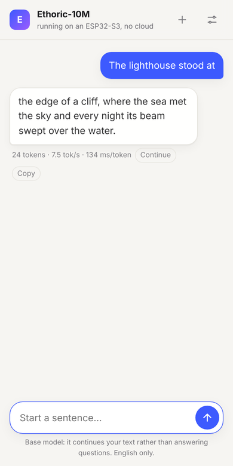
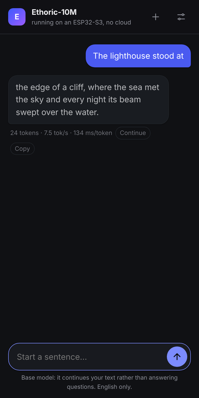

# Ethoric-ESP32

A ~10M-parameter language model, **[Ethoric-10M](https://huggingface.co/techdotus/Ethoric-10M)**, running entirely on an
**ESP32-S3** (16 MB flash, 8 MB PSRAM). No cloud, no companion computer: the board tokenizes your text, generates the
continuation at about **7.5 tokens/s**, and serves it to your phone through a small chat page over its own WiFi.

<p align="center">
  
  &nbsp;&nbsp;
  
</p>
<p align="center"><sub>The chat page served by the board (UI preview rendered with a mock backend; the text shown is sample output).</sub></p>

## At a glance

| ESP32-S3 N16R8, 240 MHz, ESP-IDF 6.1 | Measured |
|---|---|
| Decode speed | **134 ms/token (7.5 tokens/s)**, both cores |
| Model file | 7.0 MiB (int4 MLP) or ~9.8 MiB (int8) |
| Runtime RAM (context 160) | about 1 MiB |
| Quality cost vs. fp32 | W8A8: +0.11 % perplexity; int4 MLP: about +8 % |

Ask for text over **WiFi** (browser, `curl`, or `tools/chat.py`) or over **USB serial**. Like a llama.cpp server, you send
a prompt and get the whole completion back when it is done.

> **Status.** The inference engine and its speed were measured on real hardware (the numbers above). The WiFi server, chat
> page, captive portal and on-device tokenizer are newer: they are covered by host tests and a mock backend but have had
> limited testing on a board. Issues and reports are welcome.

## How it works

```
  phone / browser                         ESP32-S3
 ┌──────────────┐   HTTP, WiFi AP   ┌─────────────────────────────────────────────┐
 │  chat page   │ ────────────────► │  net_server   JSON, captive portal, DNS     │
 │  (HTML, 11KB)│ ◄──────────────── │  BPE encoder  text -> ids  (tables in .bin) │
 └──────────────┘   completion      │  Runner       12 layers, KV cache, sampler  │
                                    │  kernels      int8/int4, PIE SIMD, 2 cores  │
                                    └──────────────┬──────────────────────────────┘
                                                   │ memory-mapped / copied once
                                        flash "model" partition -> PSRAM
```

- **Compact model file (ETHW).** Weights are int8, with the MLP optionally int4, in one file with an embedded vocabulary and
  tokenizer tables, CRC-checked at boot. See [docs/MODEL_FORMAT.md](docs/MODEL_FORMAT.md).
- **Fast arithmetic.** Int8 activations (W8A8) and Xtensa PIE SIMD kernels that are verified bit-for-bit against the portable C
  reference at every boot, plus head-parallel attention across both cores. See [docs/ARCHITECTURE.md](docs/ARCHITECTURE.md).
- **Memory tiering.** Weights live in flash, are copied into PSRAM at boot, and small tables stay in internal RAM.
- **Self-contained front end.** WiFi station or access point with a captive portal, `POST /completion`, a chat page embedded in
  the firmware, and a USB serial protocol. Measurements and quality trade-offs: [docs/PERFORMANCE.md](docs/PERFORMANCE.md).

## Repository layout

```
.
├── components/ethoric/include/   # Inference engine, sampler, BPE tokenizer, JSON and DNS helpers
├── main/                         # ESP-IDF application: main.cpp, net_server.cpp, web/index.html (chat page)
├── host/                         # Desktop runner, unit tests (sampler, JSON, DNS), Makefile
├── media/                        # Screenshots used in this README
├── tools/                        # Export, chat client, reference decoder and tokenizer, HF parity check
├── tests/                        # Reference decoder tests and C++-vs-reference suite
├── docs/                         # Architecture, model format, performance notes
├── partitions.csv                # 16 MB layout with a 11 MiB "model" partition
└── sdkconfig.defaults
```

## Quick start

### 1. Get the model and export it

```bash
pip install numpy            # add `tokenizers` to use --check (compares the embedded tokenizer with the library)
git clone https://huggingface.co/techdotus/Ethoric-10M ethoric_original

# int4 MLP (7.0 MiB, fastest; fits in PSRAM together with the runtime)
python tools/export_model.py --dir ethoric_original --out ethoric_int4.bin --mlp-bits 4 --check
# int8 everywhere (best quality, ~9.8 MiB, read from flash)
python tools/export_model.py --dir ethoric_original --out ethoric_int8.bin
```

### 2. Build and flash (ESP-IDF 5.5 or newer)

```bash
cp .env.example .env              # set PORT
idf.py set-target esp32s3
make build flash                  # firmware
make flash-model MODEL=ethoric_int4.bin   # weights into the "model" partition
```

`make monitor` shows the boot log, including the board's WiFi address (see step 3). Close it before using the USB serial chat: only one program can own the serial port.

### 3. Talk to the board

The board tokenizes your text itself (the BPE tables are embedded in the model file) and returns the whole completion
when it is done, like a llama.cpp server. Pick one transport.

**WiFi (HTTP).** Put your network in `.env` (copy `.env.example` first): `WIFI_SSID=...` and `WIFI_PASSWORD=...`, then
`make build flash`, then open `make monitor`. The board prints its address as soon as it joins your network, in a line like
`connected: http://192.168.1.57:8080/completion`. **That IP can change**: your router assigns it by DHCP, so it may be different after
a reboot, a router restart or a long time off. Do not hard-code it; read it from the monitor each time (press RESET with the monitor
open to see it again), or reserve a fixed IP for the board in your router's DHCP settings if you want it to stay the same.
With no SSID set, it creates its own access
point (`AP_SSID` / `AP_PASSWORD`, default `Ethoric-ESP32` / `ethoric123`) with a **captive portal**: once a phone or PC joins, the
chat page opens by itself, and any plain-HTTP address typed in a browser is redirected to it (the board answers every DNS
name with its own address). HTTPS addresses cannot be redirected and show a certificate error. In access point mode the
server always listens on port 80 (`http://192.168.4.1/`); in station mode it uses `HTTP_PORT` (default 8080).

The examples below use the access point address `192.168.4.1`; on your home network use the IP shown in the monitor (and port 8080).

```bash
curl http://192.168.4.1/completion -d '{"prompt": "The lighthouse stood at", "n_predict": 64,
     "temperature": 0.8, "top_k": 20, "repeat_penalty": 1.2, "seed": 0}'
# {"content": " the edge of ...", "tokens_predicted": 64, "timings": {"predicted_per_token_ms": 134.0, ...}}

python tools/chat.py --url http://192.168.4.1 -p "The lighthouse stood at" -n 80
python tools/chat.py --url http://192.168.4.1 -i          # interactive
```

**From a phone or any browser:** join the same WiFi (or the board's access point) and open the board's address, e.g.
`http://192.168.4.1/` (or just open the captive-portal prompt). It is a small chat page (light/dark, mobile friendly, no internet needed) with a progress indicator, a Continue button that extends the last reply, a Copy button and a settings panel for tokens, temperature, top-k and repetition penalty. Replies appear when generation ends.

**iPhone / iPad notes.** iOS opens the page in a small "sign in to network" sheet; if it does not appear, open Safari and go to
`http://192.168.4.1/` (typing a name such as `google.com` also lands there, but only over plain `http://`). Turn off *iCloud Private
Relay* and *Limit IP Address Tracking* for this WiFi network (Settings > Wi-Fi > the (i) next to the network), and accept "stay connected"
if iOS warns that there is no internet. The page also works when opened in Safari and added to the Home Screen. The page source is `main/web/index.html`.

`GET /health` returns `{"status": "ok"}`. Requests run one at a time; a second one gets `503`.

**USB serial.** Close any serial monitor first (only one program can own the port):

```bash
pip install pyserial
python tools/chat.py --port /dev/ttyACM0 -p "The lighthouse stood at" -n 80 --temp 0.8 --top-k 20 -s 42
```

Wire protocol: request `C [n=..] [t=..] [k=..] [r=..] [s=..] |<text>\n` (`P ... <ids>` takes token ids instead); the reply is the
text followed by `@@END prompt_tokens=.. prompt_ms=.. tokens=.. ms_per_token=..`.

Both transports share one generation engine and can run at the same time. Disable WiFi with `USE_HTTP_SERVER 0`
in `main/main.cpp`.

### 4. Fixed prompt (no host needed)

```bash
python tools/tokenize_prompt.py ethoric_original "The lighthouse stood at" --write-inc main/prompt.inc
```

Only used with `CHAT_MODE 0`; otherwise you send prompts at runtime.

Set `CHAT_MODE 0` in `main/main.cpp` to generate once from `main/prompt.inc` at boot. Runtime options (context length, sampling, kernels, dual-core, PSRAM relocation) are `#define`s at the top of
`main/main.cpp`.

## Running without hardware

```bash
make -C host                      # builds host/build/ethoric_host
host/build/ethoric_host ethoric_int4.bin --ids 461,307,412,368 --new 32 --text --threads 2
host/build/ethoric_host ethoric_int8.bin --ids 461,307,412,368,1214 --ppl
make -C host test                 # sampler unit test + full test suite
```

## Verification

| Check | Command |
|---|---|
| Reference decoder vs. literal float64 transcription of the HF code | `python tests/test_reference_decoder.py` |
| C++ engine vs. reference (kernels, threads, relocation, W8A8, int4, vocabulary, CRC) | `python tests/test_cpp_decoder.py` |
| On-device BPE tokenizer vs. independent reference; round trip with non-ASCII text | `python tests/test_tokenizer.py` (set `ETHORIC_TOKENIZER` to also test a real `tokenizer.json`) |
| Reference vs. original Hugging Face model (needs `torch`, `transformers`) | `python tools/check_against_hf.py --dir ethoric_original` |
| SIMD kernels vs. C reference on the device | printed at every boot (visible with `make monitor` when `CHAT_MODE 0`) |

## Documentation

- [Architecture and optimization notes](docs/ARCHITECTURE.md)
- [ETHW model format](docs/MODEL_FORMAT.md)
- [Performance and quality measurements](docs/PERFORMANCE.md)

## License

Code: [MIT](LICENSE). The Ethoric-10M weights are distributed under their own license; see the model card.
